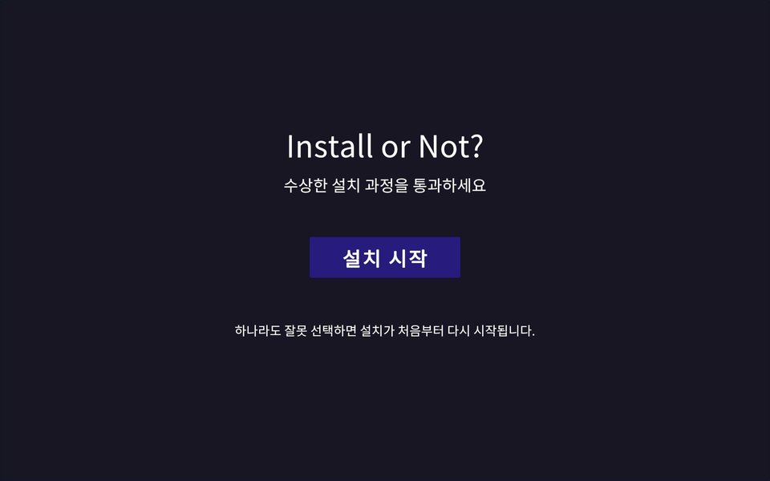
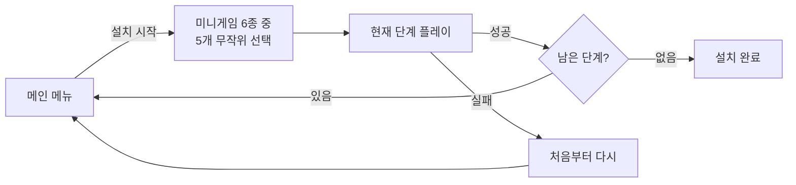
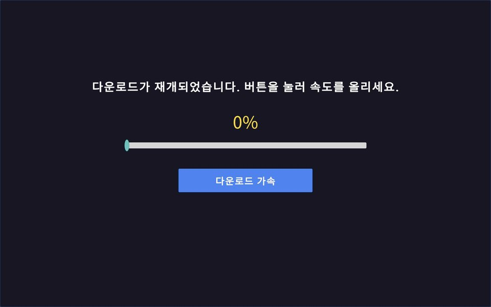
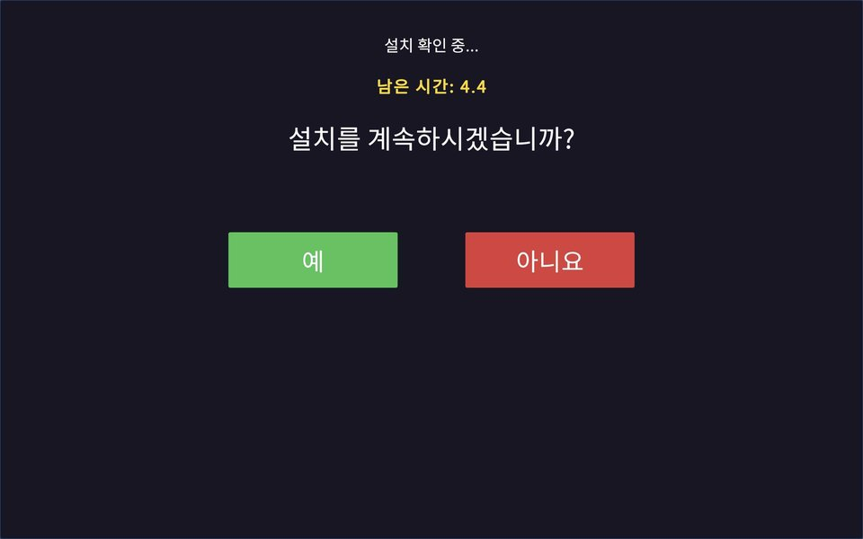
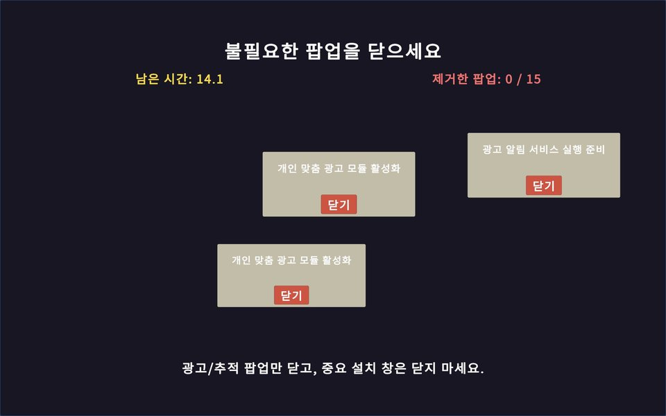
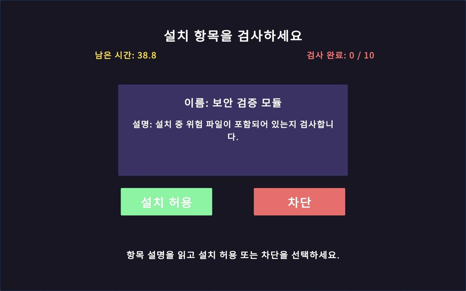
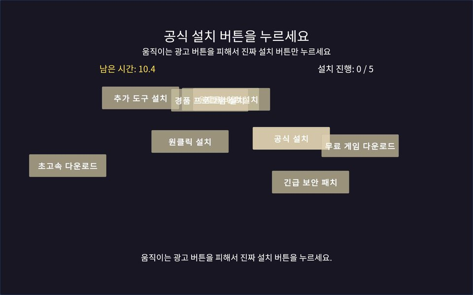
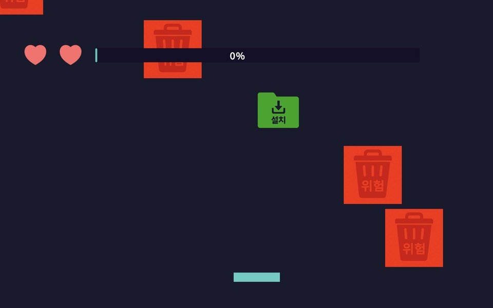
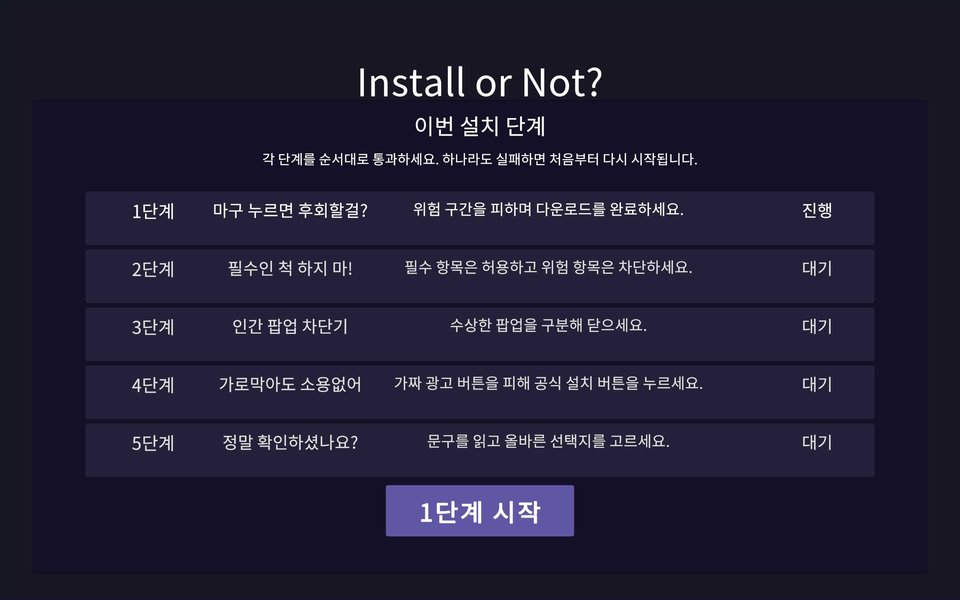
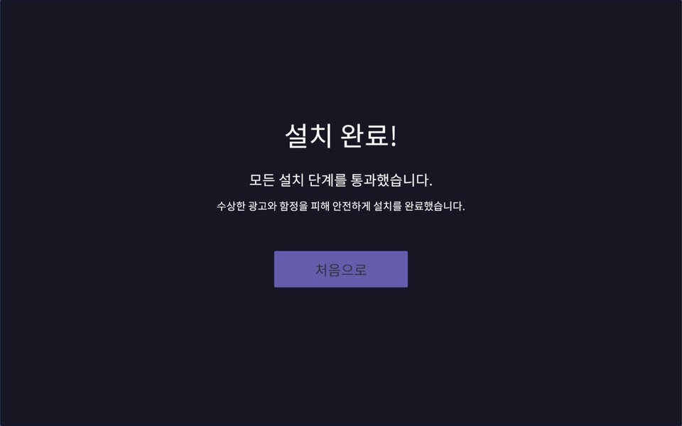

<div align="center">

# 설치 할래 말래? (Install or Not?)

**짜증나는 프로그램 설치 과정을 미니게임으로 뒤집은 모바일 캐주얼 게임**


2026-1 소프트웨어캡스톤디자인 · 팀 **공공공일공이** (3인)



▶ [시연 영상 보기](docs/demo.mp4)

</div>

---

## 기획 의도

광고 팝업, 몰래 체크된 번들 설치 체크박스, 멈춘 듯한 로딩 바 같은 **나쁜 UI/UX**는 누구나 겪는 디지털 스트레스입니다.
이 게임은 그 요소들을 피해야 할 대상이 아니라 **깨부수는 장애물**로 바꿨습니다.
짧은 미니게임 5개를 이어서 클리어하면 "설치"가 끝납니다.

## 게임 흐름



- `GameFlowManager`(싱글톤, `DontDestroyOnLoad`)가 매 회차마다 미니게임 순서를 섞고 진행 단계를 관리합니다.
- 한 단계라도 실패하면 설치가 초기화됩니다.

## 미니게임

| # | 미니게임 | 목표 | 스크린샷 |
|---|---|---|---|
| 1 | **설치 파일 다운로드** | 위험 구간을 피해 버튼을 눌러 다운로드 완료 |  |
| 2 | **확인창 함정** | 헷갈리는 문구를 읽고 맞는 선택지 고르기 |  |
| 3 | **팝업 정리** | 제한 시간 안에 수상한 팝업 닫기 |  |
| 4 | **설치 항목 검사** | 필수 항목은 허용, 위험 항목은 차단 |  |
| 5 | **광고 버튼 회피** | 가짜 광고 버튼 사이에서 진짜 설치 버튼 찾기 |  |
| 6 | **파일 수집** ⭐ | 기기를 기울여 정상 파일은 받고 악성 파일은 피하기 |  |

<p align="center">
  
  
</p>

## 내가 맡은 부분

> ⭐ 표시된 **파일 수집(Falldown)** 미니게임을 설계하고 구현했습니다.

| 파일 | 내용 |
|---|---|
| [`Falldown_Manager.cs`](Assets/Scripts/Falldown_Manager.cs) | 아이템 스폰 코루틴, 진행률·목숨 관리, 승리/패배 판정 |
| [`Falldown_controller.cs`](Assets/Scripts/Falldown_controller.cs) | **가속도 센서 기울기 조작** (에디터에서는 키보드), `Lerp`로 부드러운 이동 |
| [`Falldown_item.cs`](Assets/Scripts/Falldown_item.cs) | 낙하 아이템 (정상 파일 / 악성 파일) |
| [`Falldown_UI.cs`](Assets/Scripts/Falldown_UI.cs) | 진행 바, 목숨 표시, 결과 화면 |

- **난이도 곡선**: 진행률이 오를수록 스폰 간격은 1초에서 0.4초로 줄고, 낙하 속도는 최대 3배까지 빨라집니다.
- 정상 파일 60%, 악성 파일 40% 확률로 생성하고, 악성 파일을 2번 받으면 실패합니다.
- 게임 종료 시 화면에 남은 아이템의 충돌을 먼저 끄고 제거해서 종료 직후 판정이 다시 일어나지 않게 했습니다.

그 외 담당: 미니게임 기획, 게임 이름 짓기, 발표 PPT, 포스터, 최종 결과 보고서

## 실행 방법

1. Unity Hub에서 **Unity 2022.3.62f3**으로 이 폴더를 엽니다.
2. `Assets/Scenes/MainMenu.unity`를 열고 Play를 누릅니다.
   - 파일 수집 미니게임은 에디터에서 ← → 키로 조작합니다.
3. Android 빌드: *File → Build Settings → Android* (기울기 조작은 실기기에서 동작)

## 프로젝트 구조

```
Assets/
├── Scenes/      MainMenu, ClearScene, Minigame_* (6종)
├── Scripts/     GameFlowManager + 미니게임별 스크립트
├── Prefabs/     팝업 창, 낙하 아이템
├── Sprites/     파일/악성 파일/목숨 아이콘
└── Fonts/       Noto Sans KR (TextMeshPro SDF)
```

## 팀 & 원본 저장소

| 역할 | 담당 |
|---|---|
| 프로젝트 세팅, 저장소 관리 | [@f1s1co](https://github.com/f1s1co) |
| 미니게임 1~5, 메인/클리어 화면, 게임 흐름 | [@JooSungEom](https://github.com/JooSungEom) |
| 파일 수집 미니게임, 기획·발표·문서 | [@startercube](https://github.com/startercube) |

원본 팀 저장소: [f1s1co/Install-or-not](https://github.com/f1s1co/Install-or-not)

<details>
<summary>원본 대비 정리한 내용</summary>

- 팀 저장소의 가장 완성된 `gameflow` 브랜치를 기준으로 했습니다.
- 원본에서 커밋되지 않아 깨져 있던 파일 수집 미니게임 스프라이트(파일·악성 파일·바구니·목숨 아이콘)를 추가하고 프리팹/씬에 연결했습니다.
- CP949로 저장되어 GitHub에서 한글이 깨지던 스크립트를 UTF-8로 변환했습니다.
- 사용하지 않는 테스트 씬(`SampleScene`, `GameScenes`, `changesquare`)과 에셋, 잘못된 Git LFS 설정을 정리했습니다.

</details>
